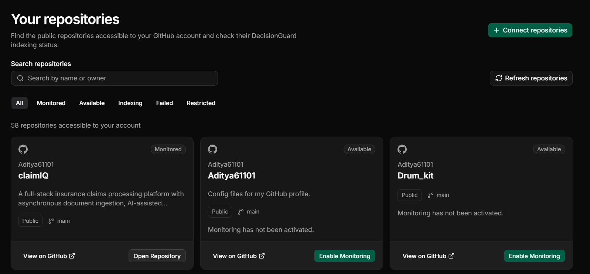
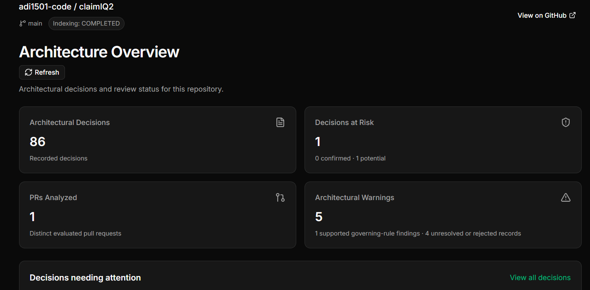
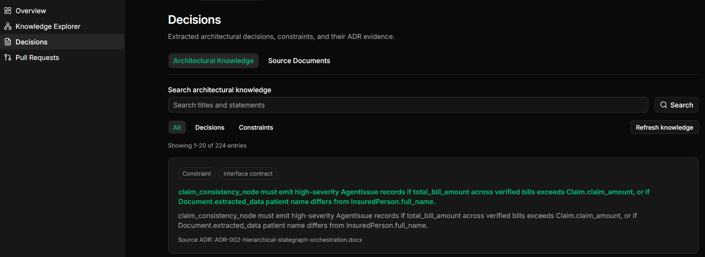
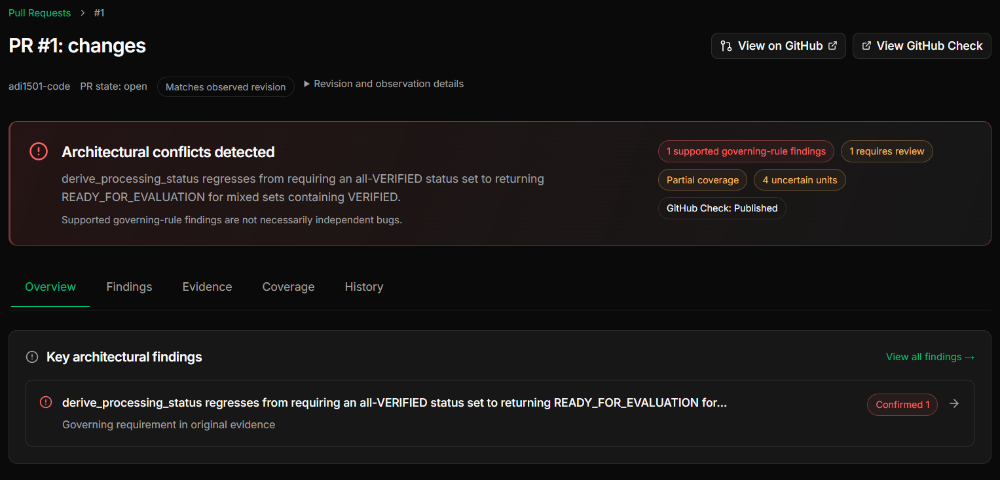
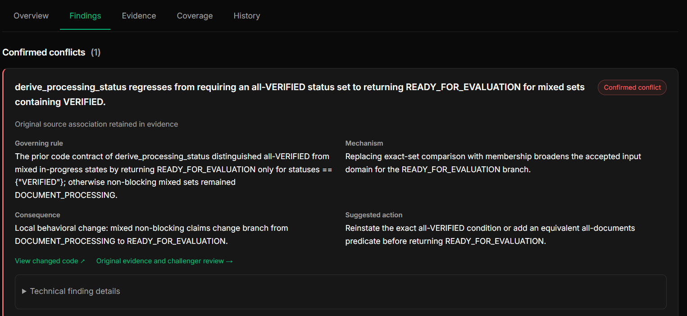
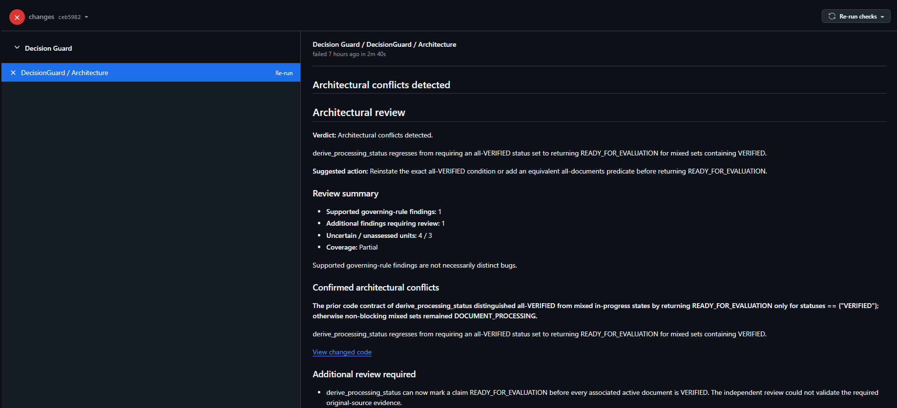

# DecisionGuard

### Active Decision Integrity for Software Architecture

**Turn architectural decisions into actionable engineering guardrails.**

DecisionGuard is a GitHub-integrated architectural review platform that analyzes pull requests against documented Architecture Decision Records (ADRs), identifies potential architectural drift, and delivers evidence-backed findings directly through GitHub Checks.

Instead of allowing architectural decisions to become forgotten documentation, DecisionGuard brings them into the development workflow—where architectural violations can be identified before code is merged.

**[Live Prototype](https://decisionguard-aibuilder-cup.web.app)** · **[Watch Demo](https://youtu.be/JnbmjAqtvnQ)**

---

## The Problem

Software teams document important architectural decisions in ADRs, RFCs, and design documents.

But as the codebase evolves, these decisions are rarely checked automatically.

A pull request might:
- Violate an established architectural constraint.
- Invalidate an assumption behind an earlier decision.
- Introduce unintended dependencies between components.
- Change business-critical behavior without corresponding architectural review.

Traditional linters, security scanners, and code-review tools are not designed to enforce a repository's documented architectural intent.

**DecisionGuard bridges the gap between architectural knowledge and code changes.**

## Key Features

| Capability | Description |
|---|---|
| GitHub App integration | Connect repositories and automatically receive pull request events |
| ADR ingestion | Extract architectural decisions, constraints, and supporting evidence from documents |
| Architecture knowledge graph | Represent relationships between architectural decisions, entities, and repository context |
| Automated PR evaluation | Analyze code changes against relevant architectural decisions |
| Evidence-backed findings | Explain conflicts using governing decisions and source-code evidence |
| GitHub Checks | Publish architectural reviews directly on pull requests |
| Review dashboard | Explore architectural decisions, reviews, and monitoring activity |
| Durable processing | Queue, retry, and recover long-running ingestion and evaluation operations |

## How DecisionGuard Works

1. **Connect** — Install the DecisionGuard GitHub App and select repositories to monitor.
2. **Build Knowledge** — Ingest ADRs and repository content to construct architectural context.
3. **Observe Changes** — Receive GitHub events whenever a pull request is opened or updated.
4. **Evaluate** — Compare proposed changes against governing architectural decisions and validate supporting evidence.
5. **Report** — Publish architectural findings, explanations, and suggested corrections through GitHub Checks.

## Technology Stack

| Layer | Technologies |
|---|---|
| Frontend | React, TypeScript, Tailwind CSS, Firebase Hosting |
| Backend | Python, FastAPI |
| AI integration | Google Vertex AI, Gemini, Gemini Embedding 2 |
| Knowledge graph | Neo4j |
| Relational persistence | PostgreSQL, Cloud SQL |
| Background processing | Cloud Run Jobs, Cloud Tasks |
| Storage | Google Cloud Storage |
| GitHub integration | GitHub App, Webhooks, GitHub REST API, GitHub Checks |
| Deployment | Cloud Run, Cloud Build, Artifact Registry, GitHub Actions |

## Prototype

The prototype demonstrates repository onboarding, architectural knowledge ingestion, decision exploration, pull request analysis, and GitHub Check publication.

## 📸 Prototype Screenshots

### 1. Repository Dashboard
Connect GitHub repositories and enable architectural monitoring.

  

### 2. Architecture Overview
Monitor architectural activity, decisions, and pull request reviews.

  

### 3. Architectural Decision Explorer
Explore extracted architectural decisions and their supporting evidence.

  

### 4. Evidence-Backed Architectural Conflict
Detect architectural violations introduced by pull request changes.

  

### 5. Findings and evidence
Understand the governing architectural decision, affected code, and supporting evidence.

  

### 6. GitHub Check Integration
View architectural findings directly in the GitHub pull request workflow.

  

## Google AI Integration

DecisionGuard includes a Vertex AI integration for architectural reasoning, structured extraction, ingestion planning, conversational analysis, and embeddings.

The Google AI implementation introduces provider-specific evaluation controls, durable request identity, and embedding-space compatibility safeguards.

## Roadmap

- Confluence and other architectural-documentation source integrations.
- Continuous monitoring of assumptions underlying accepted decisions.
- Cross-repository architectural governance.
- Change-impact simulation across components and services.
- Architectural drift analytics and historical trend analysis.

## Team

**ArchSentinel**

Built for the AI Builder Cup 2026.

**Team Lead:** Aditya Kumar